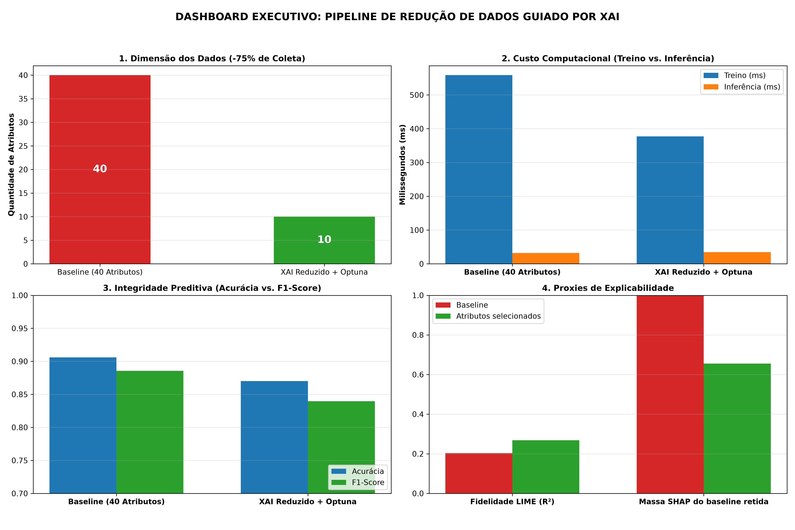

# Camada 14: Interpretacao de Resultados e Dashboard Executivo

**Trilha:** XAI Aplicada à Redução de Dados em Machine Learning
**Aplicacao:** classificacao binaria em benchmark sintetico; os rotulos de saude sao ilustrativos.
**Código de referência:** [pipeline_completo.py](../pipeline_completo.py), funções com dashboard e comparativo de KPIs

> **Objetivo da aula:** Analisar a sintese executiva e cientifica dos resultados experimentais, interpretando redução dimensional, tempo de treinamento, latencia, F1, concentração Top-10 do SHAP e esparsidade local do LIME. Esses últimos são proxies operacionais de interpretabilidade, não medidas causais nem substitutos de avaliação humana.

## Campo Didático: Um Dashboard e um Argumento

Leia cada painel em duas camadas: primeiro descreva literalmente o que o grafico mostra; depois interprete apenas o que foi medido. O roteiro e **dimensao, treino, tempo de predicao e desempenho no holdout**. O benchmark nao mede erro clinico ou custo operacional.

```text
grafico -> numero -> comparacao baseline/proposta -> limite da conclusao
```

Observe se a reducao de atributos preserva F1 e recall, e se o ganho de tempo e maior que a variacao de medicao. O erro comum e usar escala visual para sugerir uma melhora que os numeros nao sustentam. A ponte para a Camada 15 e transformar essa leitura em metodologia e hipoteses publicaveis.

---

### Roteiro de dominio

Leia o dashboard em ordem: **o que mudou, quanto mudou e quais etapas ficaram mais lentas ou mais rapidas**. Para cada painel escreva uma frase factual e uma interpretativa separadas. Nao extrapole uma unica particao sintetica para risco clinico.

### Duvidas que esta aula responde

- **Um dashboard substitui a analise estatistica?** Nao. Ele organiza evidencias; nao cria significancia.
- **Uma porcentagem de economia e universal?** Nao. Depende de hardware, volume, custos e frequencia de uso.
- **Por que mostrar baseline e campeao juntos?** Para dar escala e evitar interpretar um numero isolado.
- **O que fazer quando os indicadores discordam?** Declarar o trade-off e voltar a metrica prioritaria do dominio.

### Regra de explicacao Feynman

Explique o dashboard como o painel de um carro: ele mostra velocidade, combustivel e alertas simultaneamente. Uma unica luz verde nao autoriza dizer que a viagem inteira esta segura.

### Ler o dashboard em quatro perguntas

Cada painel responde a uma pergunta diferente:

```text
reducao dimensional  -> quantos atributos deixaram de ser usados?
tempo de treino       -> quanto custa reconstruir o modelo?
latencia              -> quanto levou a predicao do lote de teste?
F1/recall             -> quais foram as metricas no holdout?
```

Um resultado deve ser interpretado como um conjunto: a proposta reduziu atributos e o tempo de treino, mas o F1 caiu e o tempo de predicao do lote aumentou ligeiramente. Nao foram medidos volume de producao ou custos de exames.

### Como separar observacao de interpretacao

Observacao: “a proposta usou 10 atributos e teve F1 de 0,8395”. Interpretacao: “nesta particao, a reducao de 75% veio acompanhada de queda de F1 de 0,0461”. Conclusao forte demais: “os outros 30 exames sao clinicamente inuteis”. O dashboard deve ajudar a enxergar essa diferenca.

### Duvidas frequentes

- **Uma barra maior significa importancia causal?** Nao; significa o valor da metrica representada.
- **Tempo menor em uma rodada prova economia permanente?** Nao; repita em varias execucoes e considere o custo total.
- **F1 igual significa risco clinico igual?** Nao necessariamente; a composicao entre precision, recall, FP e FN pode mudar.
- **Como evitar uma escala enganosa?** Exiba unidades, baseline, numero de casos e intervalo ou variacao quando disponivel.

### Ponte para a comunicacao cientifica

O painel resume a evidencia; a Camada 15 ensina como relatar essa evidencia em IMRaD, separando resultado observado de discussao.

## Cultura, História e Referências

Dashboard executivo tem uma historia propria: a visualizacao estatistica busca reduzir carga cognitiva sem reduzir a verdade. Edward Tufte popularizou principios de clareza, comparacao e economia visual em [The Visual Display of Quantitative Information](https://www.edwardtufte.com/book/the-visual-display-of-quantitative-information/). O [dashboard_final_comparativo.png](../assets/dashboard_final_comparativo.png) deve ser usado para perguntar se a forma da imagem ajuda a conferir os numeros.

Uma boa visualizacao nao “vende” o modelo; ela torna diferencas visiveis e contestaveis. Sempre acompanhe cada painel de unidade, baseline, denominador e contexto. Evite cortar eixos para fabricar dramaticidade ou usar cor sem legenda.

**Pergunta cultural:** quem e o leitor do dashboard? Um pesquisador precisa de protocolo e limites; diferentes leitores podem ter perguntas distintas. A figura deve identificar o que foi medido.

## Recursos de Mídia (Visual e Áudio)

- **Visual local:** [Dashboard final comparativo](../assets/dashboard_final_comparativo.png), com dimensão, treino, latência e F1.
- **Imagem incorporada:**


- **Referencia visual:** principios de [The Visual Display of Quantitative Information](https://www.edwardtufte.com/book/the-visual-display-of-quantitative-information/).
- **Áudio sugerido:** um painel para pesquisador, gestor e equipe clínica, mostrando que cada público pergunta algo diferente.
- **Imagem mental:** quatro paineis formando uma decisao, nao quatro graficos isolados.

## 📊 Elementos de Comunidade e Status

- **Status:** `Resultado comunicado` quando observação, interpretação e recomendação estiverem separadas.
- **Debate:** “Qual painel mudaria sua decisao de implantacao e por que?”
- **Papel rotativo:** designer, estatistico, gestor e profissional de saude.

## 💡 Engajamento e Conhecimento

- **Atividade:** uma leitura de 60 segundos do dashboard é feita sem adjetivos.
- **Produto da aula:** legenda executiva com baseline, unidade, denominador, ganho e limite.
- **Conexao profissional:** transformar numeros em decisao sem esconder FN, custo ou variacao.

## Mapa da aula

1. [Subcamada 14.1: O conceito na vida real](#subcamada-141-o-conceito-na-vida-real)
2. [Subcamada 14.2: Desenhando o conceito](#subcamada-142-desenhando-o-conceito)
3. [Subcamada 14.3: Desmistificando a teoria e a notacao formal](#subcamada-143-desmistificando-a-teoria-e-a-notacao-formal)
4. [Subcamada 14.4: Laboratorio ludico no Colab](#subcamada-144-laboratorio-ludico-no-colab)
5. [Subcamada 14.5: O momento serio da nossa aplicacao](#subcamada-145-o-momento-serio-da-nossa-aplicacao)
6. [Subcamada 14.6: Checkpoint de autonomia e fixacao ativa](#subcamada-146-checkpoint-de-autonomia-e-fixacao-ativa)

---

## Subcamada 14.1: O conceito na vida real

### A analogia dos quatro mostradores na cabine de voo

Em uma aeronave comercial durante o procedimento de descida e pouso, o comandante nao analisa linhas de codigo dos computadores de bordo; ele monitora um painel com quatro instrumentos essenciais:
1. **Peso total da aeronave:** aeronaves mais leves demandam pistas menores e consomem menos combustivel por milha nautica.
2. **Temperatura e potencia dos motores:** reflete a sobrecarga termica do sistema durante o voo.
3. **Tempo de resposta dos atuadores mecanicos:** a agilidade em milissegundos com que as asas respondem aos comandos do manche em situacoes de turbulencia severa.
4. **Horizonte artificial e altitude:** a estabilidade de navegacao que garante a integridade fisica de passageiros e tripulacao.

Na apresentacao dos resultados, compare dimensao, desempenho e tempos medidos sob o mesmo protocolo. Os dados sao sinteticos: a reducao de atributos nao mede exames coletados, custo hospitalar ou eficacia diagnostica.

### O debate metodologico: custo medido e escopo das conclusoes

Uma objecao frequente apresentada por avaliadores diz respeito ao esforco computacional dispendido nas fases de explicabilidade: *"O calculo analitico de valores SHAP, a avaliacao da curva de ablacao e a busca bayesiana com Optuna nao consomem tempo relevante de CPU?"*

Os tempos de selecao, treino e predicao medem etapas diferentes e devem ser reportados separadamente. Esta execucao nao mediu implantacao, custos de producao ou efeitos em pacientes.

| Metrica | Baseline (40 atributos) | Proposta (10 atributos) |
| :--- | :--- | :--- |
| Atributos | 40 | 10 |
| Informativos retidos (sinteticos) | 10/10 | 7/10 |
| F1 no holdout | 0,8856 | 0,8395 |
| Acuracia no holdout | 0,9060 | 0,8700 |
| Treino (ms) | 558,5 | 377,3 |
| Predicao do lote de teste (ms) | 32,14 | 34,49 |
| Selecao de atributos (s) | 0,00 | 14,17 |

Nesta particao, a reducao de atributos foi de 75% e a queda de F1 foi de 0,0461, dentro por pouco do limite de 0,05 definido para H1. O tempo de treino caiu, mas a predicao do lote de teste ficou ligeiramente mais lenta; a selecao levou mais tempo que RFE (3,07 s). Esses resultados sao descritivos de uma execucao.

---

## Subcamada 14.2: Desenhando o conceito

O diagrama abaixo sintetiza a disposicao dos quatro quadrantes do dashboard executivo gerado pelo pipeline:

```text
==================================================================================
                 PAINEL EXECUTIVO: CONFRONTO BASELINE VS. MODELO XAI
==================================================================================
 QUADRANTE 1: ATRIBUTOS SINTETICOS          QUADRANTE 2: TEMPO DE TREINO
   40 | [==========] 40 atributos            600 | [==========] 558.5 ms
   30 |                                      600 | 
   20 |                                      400 | 
   10 | [===] 10 atributos (-75.0%)          200 | [======] 377.3 ms
    0 +--------------------------              0 +--------------------------
        Baseline     Campeao XAI                   Baseline     Campeao XAI
----------------------------------------------------------------------------------
 QUADRANTE 3: PREDICAO DO HOLDOUT (ms)     QUADRANTE 4: F1 NO HOLDOUT
   40 | [=========] 32.14 ms                 1.0 | [=======] 0.8856  [======] 0.8395
   30 |                                      0.8 |
   20 |                                      0.6 |
   10 | [==========] 34.49 ms                0.4 |
    0 +--------------------------            0.0 +--------------------------
        Baseline     Campeao XAI                   Baseline (40)  Campeao (10)
==================================================================================
```

A comparacao nao estima retorno operacional nem desempenho futuro:

```text
[ ETAPA DE SELECAO ]                       [ MODELO NO HOLDOUT ]
Tempo medido nesta execucao:               Resultados observados:
• shap-select + Optuna: 14.17 s            • F1: 0.8395 (baseline: 0.8856)
• RFE: 3.07 s                              • Predicao do lote: 34.49 ms (baseline: 32.14 ms)
      │                                          │
      ▼                                          ▼
[ CUSTO DE SELECAO ]                       [ UMA PARTICAO SINTETICA ]
```

| Quadrante | Metrica Apresentada | Leitura Tecnica | Significado Institucional |
| :--- | :--- | :--- | :--- |
| **Q1 (Atributos)** | $M_{\text{inicial}} \to M_{\text{final}}$ | 40 para 10 atributos sinteticos | Reducao dimensional de 75% neste split |
| **Q2 (Treinamento)** | Tempo de ajuste (ms) | 558,5 para 377,3 ms | Medicao dependente da maquina |
| **Q3 (Predicao)** | Tempo para prever o lote de teste (ms) | 32,14 para 34,49 ms | Sem ganho nesta medicao |
| **Q4 (Desempenho)** | $F_1$-Score e Acuracia | F1 0,8856 para 0,8395 | Queda de F1 de 0,0461 neste holdout |

---

## Subcamada 14.3: Desmistificando a teoria e a notacao formal

### Metricas de eficiencia e reducao dimensional

A taxa de reducao volumetrica no espaco de entrada e expressa como:

$$\Delta_p = \left( 1 - \frac{p_{\text{reduzido}}}{p_{\text{bruto}}} \right) \times 100\%$$

Em nosso experimento oficial: $\Delta_p = (1 - 10/40) \times 100\% = 75.0\%$.

### Aceleracao computacional (*Speedup*)

A razao de ganho de velocidade (speedup) no treinamento e na inferencia e formalizada por:

$$S_{\text{train}} = \frac{T_{\text{train}}(\text{Baseline})}{T_{\text{train}}(\text{Proposta})}, \quad S_{\text{infer}} = \frac{\tau_{\text{infer}}(\text{Baseline})}{\tau_{\text{infer}}(\text{Proposta})}$$

Nesta execucao, $S_{\text{train}} \approx 1.48$, enquanto $S_{\text{infer}} \approx 0.93$ para o lote de teste; portanto, o treino foi mais rapido e a predicao do lote nao.

### Gap de generalizacao (Monitoramento de Overfitting)

A reducao do gap entre o desempenho de treino e teste formaliza o combate ao sobreajuste:

$$\text{Gap}_{\text{overfit}} = \text{Acuracia}_{\text{treino}} - \text{Acuracia}_{\text{teste}}$$

O pipeline nao exporta uma metrica de gap de generalizacao nesta tabela. Nao se deve inferir reducao de overfitting apenas a partir da quantidade de atributos ou da diferenca de F1 no holdout.

| Simbolo | Significado Formal | Leitura no Projeto |
| :--- | :--- | :--- |
| $\Delta_p$ | Taxa percentual de reducao de dimensionalidade | Eliminacao de 75% dos atributos sinteticos |
| $S_{\text{train}}$ | Fator de aceleracao no tempo de treinamento | Aproximadamente 1,48 nesta medicao |
| $S_{\text{infer}}$ | Fator entre tempos de predicao do lote | Aproximadamente 0,93; sem ganho nesta medicao |
| $\text{Gap}_{\text{overfit}}$ | Diferenca entre desempenho de treino e teste | Nao calculada nem exportada pelo pipeline |
| $F_1$ | Media harmonica entre precisao e recall | 0,8856 no baseline e 0,8395 na proposta |

### A ordem correta evita distorcoes

Todas as metricas apresentadas nos quadrantes de treinamento e desempenho devem ser apuradas rigorosamente sob o mesmo particionamento inicial de dados. Modificar a divisao de treino/teste entre os modelos invalidaria as comparacoes de speedup e $F_1$.

---

## Subcamada 14.4: Laboratorio ludico no Colab

Execute o bloco abaixo no Google Colab para renderizar os quatro quadrantes do dashboard executivo:

```python
# =============================================================================
# CAMADA 14: LABORATORIO LUDICO DO DASHBOARD EXECUTIVO
# Demonstracao: Plotagem Comparativa dos 4 Quadrantes Estrategicos
# =============================================================================
import matplotlib.pyplot as plt
import pandas as pd

# Os valores sao lidos da execucao mais recente do pipeline.
resultados = pd.read_csv("assets/tabela_comparativa_completa.csv")
baseline = resultados.loc[resultados["Familia"] == "Referência"].iloc[0]
proposta = resultados.loc[
    resultados["Metodo"] == "XAI Proposto (shap-select + Optuna)"
].iloc[0]
modelos = ["Baseline (40)", "Proposta (10)"]
paleta = ["#7f8c8d", "#2980b9"]
reducao = (1 - proposta["N_Atributos"] / baseline["N_Atributos"]) * 100

# 2 linhas x 2 colunas formam os quatro quadrantes do dashboard.
fig, eixos = plt.subplots(2, 2, figsize=(11, 7.5))

# Quadrante 1: atributos sinteticos selecionados.
eixos[0, 0].bar(modelos, [baseline["N_Atributos"], proposta["N_Atributos"]], color=paleta, width=0.45, edgecolor="black")
eixos[0, 0].set_title("1. Atributos Sinteticos", fontsize=10, fontweight="bold")
eixos[0, 0].set_ylabel("Quantidade de Atributos", fontsize=9)
eixos[0, 0].text(1, proposta["N_Atributos"] + 2, f"-{reducao:.1f}%", ha="center", fontsize=10, fontweight="bold")
eixos[0, 0].grid(axis="y", linestyle=":", alpha=0.6)

# Quadrante 2: milissegundos gastos para ajustar a floresta.
eixos[0, 1].bar(modelos, [baseline["Tempo_Treino_ms"], proposta["Tempo_Treino_ms"]], color=paleta, width=0.45, edgecolor="black")
eixos[0, 1].set_title("2. Tempo de Treinamento (ms)", fontsize=10, fontweight="bold")
eixos[0, 1].set_ylabel("Milissegundos", fontsize=9)
eixos[0, 1].grid(axis="y", linestyle=":", alpha=0.6)

# Quadrante 3: tempo de predicao do lote de teste.
eixos[1, 0].bar(modelos, [baseline["Latencia_Inf_ms"], proposta["Latencia_Inf_ms"]], color=paleta, width=0.45, edgecolor="black")
eixos[1, 0].set_title("3. Predicao do Lote de Teste (ms)", fontsize=10, fontweight="bold")
eixos[1, 0].set_ylabel("Milissegundos", fontsize=9)
eixos[1, 0].grid(axis="y", linestyle=":", alpha=0.6)

# Quadrante 4: F1 no holdout sintetico.
eixos[1, 1].bar(modelos, [baseline["F1_Score"], proposta["F1_Score"]], color=paleta, width=0.45, edgecolor="black")
eixos[1, 1].set_title("4. F1 no Holdout Sintetico", fontsize=10, fontweight="bold")
eixos[1, 1].set_ylabel("F1-Score no Teste Cego", fontsize=9)
eixos[1, 1].grid(axis="y", linestyle=":", alpha=0.6)

plt.suptitle("DASHBOARD EXECUTIVO COMPARATIVO: XAI APLICADA A REDUCAO DE DADOS", fontsize=12, fontweight="bold")
plt.tight_layout()
plt.show()
```

> **O que voce deve notar no grafico gerado:**
> 1. A proposta usa menos atributos e teve menor tempo de treinamento nesta execucao.
> 2. O F1 caiu 0,0461 e a predicao do lote foi ligeiramente mais lenta; estes resultados nao demonstram seguranca ou beneficio clinico.

**Mini-experimento:** use o CSV para comparar a selecao da proposta com RFE. O que a diferenca de tempo permite concluir sobre H2 nesta execucao?

---

## Subcamada 14.5: O momento serio da nossa aplicacao

> **Chega de brinquedo!** Agora que o conceito esta cristalino, vamos para a trincheira real da nossa aplicacao com os dados do projeto.

No fechamento do projeto de reducao de dimensionalidade, emitimos o quadro consolidado oficial de KPIs cruzando todas as dimensoes operacionais, estatisticas e clinicas.

```python
# =============================================================================
# APLICACAO AO BENCHMARK: QUADRO COMPARATIVO DA EXECUCAO ATUAL
# Os valores sao lidos do CSV gerado pelo pipeline.
# =============================================================================
import pandas as pd

resultados = pd.read_csv("assets/tabela_comparativa_completa.csv")
baseline = resultados.loc[resultados["Familia"] == "Referência"].iloc[0]
proposta = resultados.loc[
    resultados["Metodo"] == "XAI Proposto (shap-select + Optuna)"
].iloc[0]
quadro_resultados = pd.DataFrame([
    {"Metrica": "Atributos sinteticos", "Baseline": baseline["N_Atributos"], "Proposta": proposta["N_Atributos"]},
    {"Metrica": "F1 no holdout", "Baseline": baseline["F1_Score"], "Proposta": proposta["F1_Score"]},
    {"Metrica": "Acuracia no holdout", "Baseline": baseline["Acuracia"], "Proposta": proposta["Acuracia"]},
    {"Metrica": "Recall no holdout", "Baseline": baseline["Recall"], "Proposta": proposta["Recall"]},
    {"Metrica": "ROC-AUC no holdout", "Baseline": baseline["ROC_AUC"], "Proposta": proposta["ROC_AUC"]},
    {"Metrica": "Treino (ms)", "Baseline": baseline["Tempo_Treino_ms"], "Proposta": proposta["Tempo_Treino_ms"]},
    {"Metrica": "Predicao do lote de teste (ms)", "Baseline": baseline["Latencia_Inf_ms"], "Proposta": proposta["Latencia_Inf_ms"]},
    {"Metrica": "Selecao (s)", "Baseline": baseline["Tempo_Selecao_s"], "Proposta": proposta["Tempo_Selecao_s"]},
])

print("=" * 82)
print("QUADRO OFICIAL CONSOLIDADO DE KPIS: BASELINE VS. MODELO REDUZIDO CAMPEAO")
print("=" * 82)
print(quadro_resultados.to_string(index=False))
print("=" * 82)
```

### Tabela oficial de KPIs

> Os valores abaixo sao produzidos pelo codigo, nao devem ser decorados como constantes. Tempo, latencia e ate pequenas variacoes de desempenho dependem do ambiente e da versao das bibliotecas.

| KPI | Como e calculado | Pergunta operacional |
| :--- | :--- | :--- |
| **Reducao de atributos (%)** | $(1 - p_{\text{proposta}} / p_{\text{baseline}}) \times 100$ | Qual foi a reducao neste benchmark? |
| **F1 no holdout** | Media harmonica de precisao e recall | A queda ficou dentro do criterio predefinido de H1? |
| **Tempo de selecao** | Segundos medidos no pipeline | Como se compara a selecao com RFE? |
| **Fidelidade LIME** | $R^2$ do substituto em uma observacao | Qual foi o ajuste local e qual o limite dessa observacao? |

### Interpretacao do benchmark sintetico

Os KPIs descrevem somente esta execucao:

1. **Desempenho:** o F1 caiu 0,0461, dentro por pouco da margem definida para H1 nesta particao.
2. **Custo medido:** o treino foi mais rapido, mas a selecao foi mais lenta que RFE e a predicao do lote aumentou ligeiramente.
3. **Limites:** nao foram medidos custos de exames, uso clinico, escalabilidade ou desempenho em dados externos.

---

## Subcamada 14.6: Checkpoint de autonomia e fixacao ativa

Explique sem consultar o texto e depois confira sua resposta:

1. **Como comparar a queda de F1 observada com o limite predefinido de H1?**
2. **Qual e a resposta metodologica para questionamentos sobre o custo computacional consumido nas fases de explicabilidade e busca bayesiana?**
3. **O que permite concluir a rejeicao de ruido sintetico neste benchmark?**
4. **Como interpretar o tempo de predicao medido para o lote de teste?**
5. **Quais afirmacoes exigiriam repeticoes, dados externos ou avaliacao humana?**
6. **Como os quatro quadrantes do dashboard resumem os resultados sem sugerir uso clinico?**

### Mini-desafio pratico

Use o CSV atualizado para comparar o tempo de selecao da proposta com RFE e discuta o que essa medicao permite concluir sobre H2.

**Pergunta reflexiva:** que evidencias adicionais seriam necessarias para extrapolar estes resultados para dados reais?
